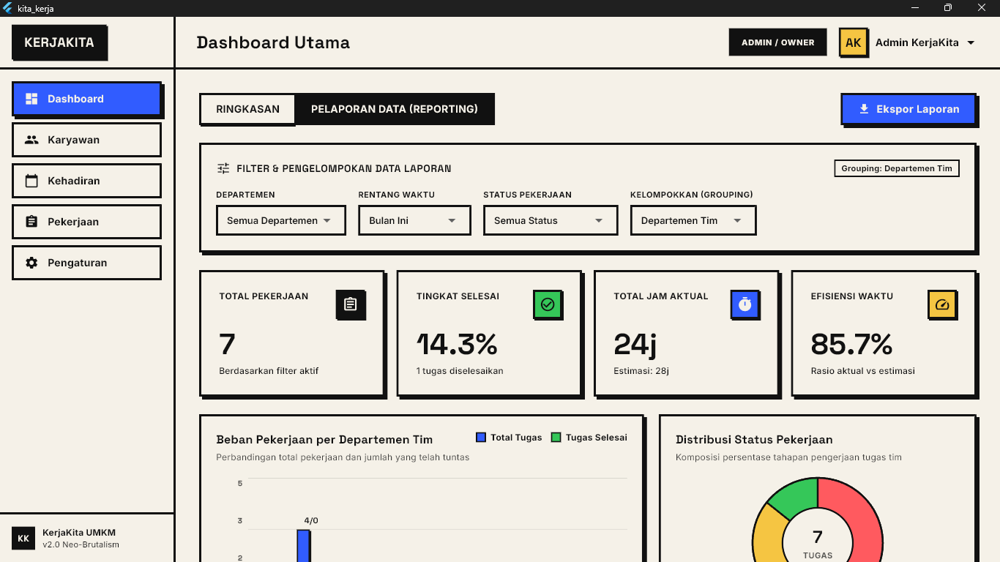
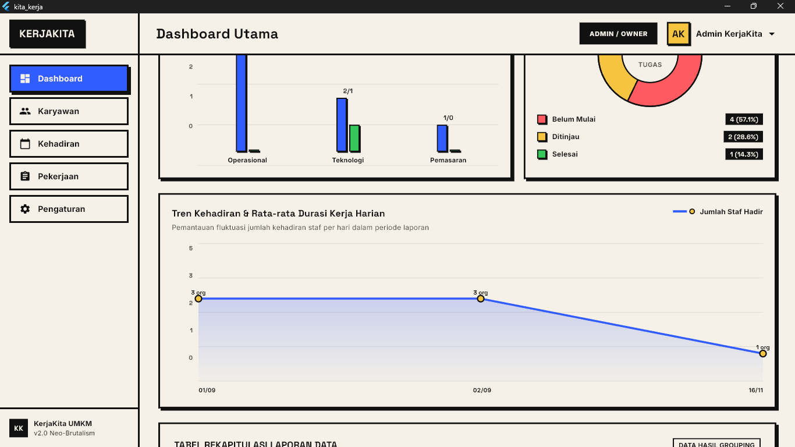
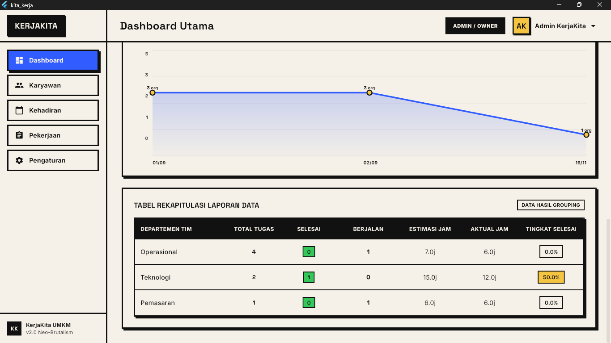

# KerjaKita 💼

**Sistem Manajemen Tenaga Kerja untuk UMKM**  
_Versi 1.0 (MVP)_

---

## Anggota Kelompok

- **Febiandi Hafiz Pratama** - 25082010215 (Captain).
- **Rasya Febrian Susanto** - 25082010232 (Hipster).
- **Nabil Ilham Hanafi** - 25082010223 (Hustler).
- **Achmadillah Yusuf Faqih Febrianto** - 25082010193 (Hacker).

## 📌 Ringkasan Produk

**KerjaKita** adalah aplikasi manajemen tenaga kerja berbasis desktop (Flutter) yang dirancang khusus untuk memenuhi kebutuhan Usaha Mikro, Kecil, dan Menengah (UMKM). Aplikasi ini memusatkan pengelolaan data karyawan, pencatatan kehadiran, pembagian pekerjaan, analisis beban kerja, hingga informasi penggajian dalam satu sistem yang terstruktur dan mudah digunakan.

Aplikasi ini juga selaras dengan mendukung pencapaian **SDG 8 (Decent Work and Economic Growth)** melalui transparansi kompensasi, digitalisasi pencatatan kerja, serta evaluasi beban kerja secara berkelanjutan.

---

## 🎯 Tujuan Utama

- **Sentralisasi Data**: Memusatkan seluruh data karyawan dan master data usaha dalam satu platform.
- **Efisiensi Kehadiran**: Memudahkan pencatatan masuk/pulang kerja, durasi jam kerja, dan perhitungan lembur.
- **Manajemen Pekerjaan**: Mendistribusikan dan memantau progres tugas harian/proyek secara efisien.
- **Monitoring Beban Kerja**: Menyajikan indikator beban kerja (% jam kerja vs kapasitas) untuk mencegah kelelahan atau ketimpangan pembagian tugas.
- **Transparansi Gaji**: Menyediakan rincian gaji pokok, lembur, bonus, dan potongan secara terstruktur.

---

## 👥 Role Pengguna & Hak Akses

| Fitur                 |   Admin / Owner    |  Manager / Supervisor   |        Karyawan         |
| :-------------------- | :----------------: | :---------------------: | :---------------------: |
| **Dashboard**         | Full (Keseluruhan) |       View (Tim)        |     View (Pribadi)      |
| **Karyawan**          |        Full        |        View Tim         |      Data Sendiri       |
| **Kehadiran**         |        Full        |       View/Review       |  Clock-in / Clock-out   |
| **Pekerjaan**         |        Full        |          Full           | Tugas Sendiri & Progres |
| **Beban Kerja**       |        Full        |          Full           |      Data Sendiri       |
| **Gaji**              |        Full        | View (Sesuai Kebutuhan) |      Data Sendiri       |
| **Data Master**       |        Full        |          View           |       Tidak Akses       |
| **Profil & Keamanan** |    Data Sendiri    |      Data Sendiri       |      Data Sendiri       |

---

## 🧭 Struktur Navigasi & Fitur Utama

1. **Dashboard**: Menampilkan statistik KPI utama, tab **Pelaporan Data (Reporting)** dengan filtering & grouping dinamis, 3 varian chart interaktif (Bar, Line, Pie), serta peringatan beban kerja tim.
2. **Karyawan**: Pengelolaan data karyawan (CRUD), referensi jabatan, departemen, jenis gaji, dan jadwal kerja.
3. **Kehadiran**: Pencatatan waktu Masuk & Pulang kerja, kalkulasi jam kerja serta menit lembur.
4. **Pekerjaan**: Pembuatan & penugasan pekerjaan dengan alur status (`Belum Mulai` → `Sedang Dikerjakan` → `Ditinjau` → `Selesai`).
5. **Beban Kerja**: Kalkulasi persentase kapasitas vs estimasi/aktual waktu kerja karyawan.
6. **Gaji**: Rincian payroll (Gaji Pokok, Lembur, Bonus, Potongan, Gaji Bersih).
7. **Pengaturan**:
   - **Profil**: Pengaturan akun pribadi.
   - **Data Master**: Jabatan, Departemen, Kategori Pekerjaan, Jenis Gaji, Jadwal Kerja.
   - **Keamanan**: Pengaturan kata sandi dan autentikasi.

---

## 📸 Tangkapan Layar Implementasi Dashboard & Chart Reporting

Berikut adalah tangkapan layar hasil implementasi fitur pelaporan data dan visualisasi chart pada Dashboard KerjaKita dengan gaya antarmuka **Neo-Brutalism**:

### 1. Filter Dinamis & Ringkasan KPI Laporan
Filter data interaktif (Departemen, Rentang Waktu, Status Pekerjaan, serta Grouping Dinamis) disertai 4 kartu metrik performa (Total Pekerjaan, Tingkat Selesai, Jam Aktual, dan Efisiensi Waktu).



### 2. Tiga Jenis Chart Interaktif (Bar Chart, Pie Chart, & Line Chart)
Visualisasi multi-dimensi yang menampilkan:
- **Bar Chart**: Grafik batang ganda perbandingan total beban tugas vs tugas tuntas berdasarkan pengelompokan.
- **Pie / Donut Chart**: Distribusi proporsi status tugas (*Belum Mulai*, *Ditinjau*, *Selesai*) lengkap dengan total di tengah donat dan legenda persentase.
- **Line Chart**: Area grafik garis tren fluktuasi jumlah kehadiran staf per hari.



### 3. Tren Kehadiran & Tabel Rekapitulasi Data Laporan
Tampilan grafik garis tren kehadiran harian yang dipadukan dengan tabel rekapitulasi data hasil *grouping* (merinci total tugas, status, estimasi jam, jam aktual, dan rasio penyelesaian).



---

## 🎨 Panduan UI/UX

Sistem antarmuka KerjaKita mengusung gaya **Professional Neo-Brutalism** dengan karakteristik:

- **Target Resolusi**: Desktop 1366×768 / 1440×900
- **Skema Warna**:
  - Background: `#F5F1E8` (Warm Off-white)
  - Teks / Border: `#111111` (Deep Dark)
  - Primary: `#315CFF` (Electric Blue)
  - Secondary: `#F5C542` (Mustard Yellow)
  - Success: `#35C759` (Bright Green)
  - Danger: `#FF5A5F` (Coral Red)
- **Elemen Desain**: Border tegas, offset shadow ringan, tipografi bold, dan bentuk geometris sederhana tanpa dekorasi berlebihan.

---

## 🗄️ Arsitektur Data & DBMS

Sistem menggunakan **MySQL 8.x** sebagai DBMS backend dengan alur data utama:

```text
Data Master ──> Karyawan ──> Pekerjaan + Kehadiran ──> Beban Kerja ──> Gaji ──> Dashboard & Evaluasi
```

---

## 🚀 Cara Menjalankan Aplikasi

### Prasyarat

- Flutter SDK (Channel stable)
- Dart SDK
- Desktop Development Target (Windows/macOS/Linux)

### Langkah Jalankan

1. **Clone repository & masuk ke direktori proyek**:

   ```bash
   git clone https://github.com/d4goat/kita-kerja
   cd kita-kerja
   ```

2. **Install dependensi**:

   ```bash
   flutter pub get
   ```

3. **Jalankan aplikasi (Desktop Windows)**:
   ```bash
   flutter run -d windows
   ```

---

_KerjaKita — Empowering UMKM Workforce Management_
